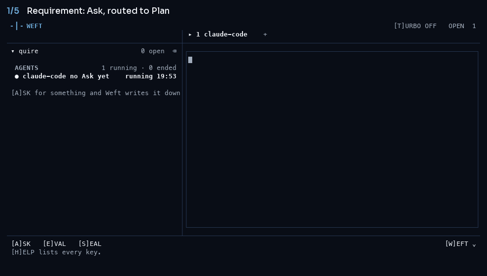

<p align="center">
  <picture>
    <source media="(prefers-color-scheme: dark)" srcset="assets/weft-banner-dark.svg">
    
  </picture>
</p>

<p align="center">
  
</p>
<p align="center"><sub>Weft's own screens, drawn from one recorded session; no agent runs.
<a href="https://docs.getfab7.com/weft/getting-started">Get started</a> ·
<a href="https://docs.getfab7.com/weft/sdlc">Map your SDLC</a></sub></p>

Weft is the terminal workspace for the coding agents you already run: your
sessions side by side, and every Ask in one list beside them. It has no model
of its own. RingFrame is the warp, the fixed record; Weft is the thread carried
across it.

## What is here

- `weft`, `weftd`: the terminal UI and the daemon that keeps your agents running
- `crates/ringframe`: Ask, Eval and Seal over the record in `.fab7/rf/`
- [weft.getfab7.com](https://weft.getfab7.com): the same agents from a phone
  or browser ([fab7hq/weft-app](https://github.com/fab7hq/weft-app))

Works with Claude Code, Codex, Antigravity and Grok Build.

## Install

```sh
curl -fsSL https://github.com/fab7hq/weft/releases/latest/download/install.sh | sh
```

Run `weft` in a repository. `weft update` installs the next release.

## Docs

Setting up your harness, the loop from Ask to Seal, and Weft on your phone:
**[docs.getfab7.com](https://docs.getfab7.com)**.

## Development

```sh
cargo build
cargo nextest run --workspace
./bin/reinstall-local   # build, install and restart the daemon, as users get it
```

Docs and their walkthroughs live in [fab7hq/docs](https://github.com/fab7hq/docs),
pinned to a Weft release.

## Releases

Tagged `vX.Y.Z`: [Releases](https://github.com/fab7hq/weft/releases). Weft,
RingFrame and the `rf` plugins in [fab7hq/fab7](https://github.com/fab7hq/fab7)
share one version.

## License

Apache-2.0. Part of [Fab7](https://getfab7.com).
